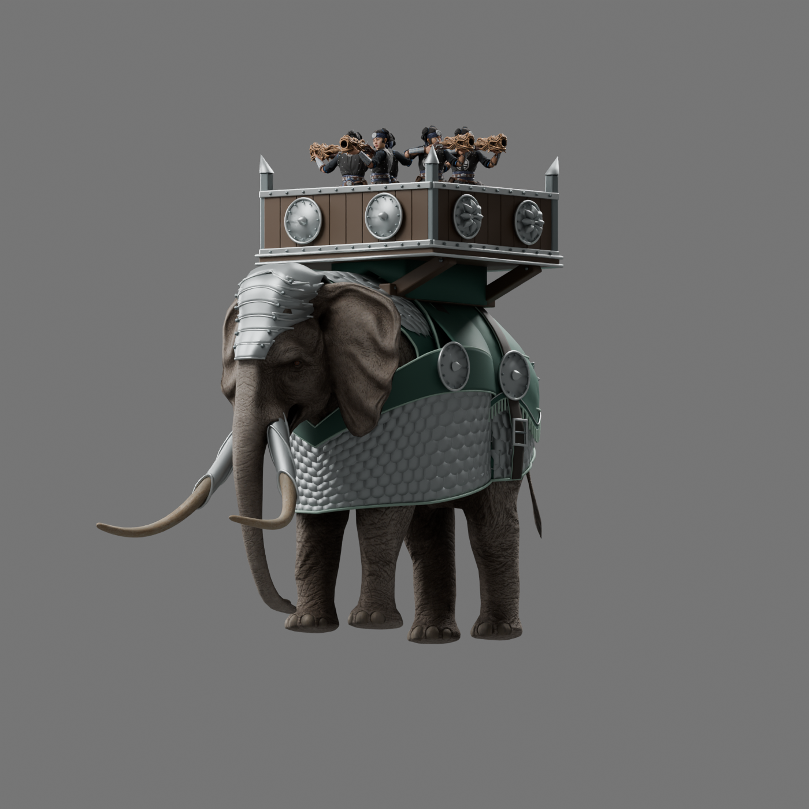
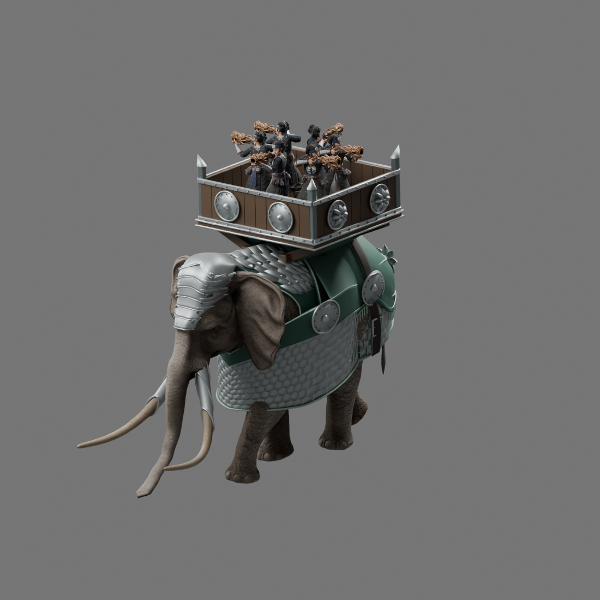

# Cathay war elephant: editable checkpoint

Saved at the user's explicit request on 2026-11-28. Both Blender files contain the model and packed textures, rather than links to ignored local build files. Open with Blender 4.5 LTS; no importer add-on or local game installation is required to view or play the scene.

- `cathay-war-elephant-approved.blend`: approved static appearance, with a continuous armoured coat, wooden platform braces, matching front/rear round fittings and six Cathay Iron Hail Gunners. Straps stop within the armour area.
- `cathay-war-elephant-animation-trial.blend`: the same appearance fitted to the original OvN elephant skeleton and six native clips. Press Space to play. The timeline starts on the walking segment and has named clip markers.
- `portability.json`: file hashes, packed image counts and dependency audit.

| Clip | Frames |
| --- | --- |
| Stand | 1–133 |
| Walk | 134–190 |
| Run | 191–227 |
| Charge | 228–250 |
| Charge attack | 251–283 |
| Stomp attack | 284–328 |

The animation scene is a fitting trial. Front legs intersect the breast apron during the rearing/stomp action; further rig fitting is required. The gunners retain their approved aim pose and move with the platform; no firing animation is included. Horizontal root travel is removed for viewing in place. The native body weights are retained, while custom armour uses a shared longitudinal spine weight field.

Source elephant and animations: **OvN Lost Factions: Araby**. Crew and game textures: **Total War: WARHAMMER III**. The custom armour layout references user-supplied elephant images and Jade Lancer material finishes. This scoped editable backup does not establish redistribution rights for source assets.

Unrelated hidden model studies and reference pictures were omitted from these copies. The original local review scenes remain unchanged. No game pack, v52 integration, runtime validation or Workshop publishing is included.

