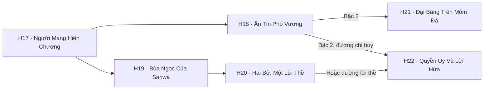
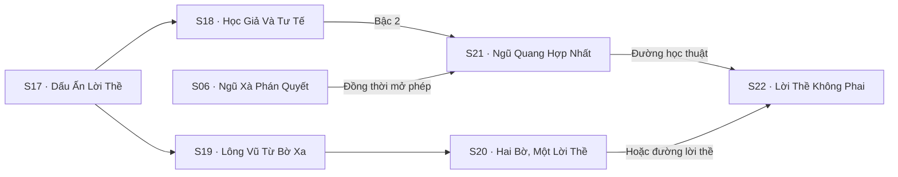

> BẢN CŨ ĐÃ BỎ. Dùng Heinrich-Sariwa-Skill-Tree-v2-Vanilla.md thay thế.

# Hiến Chương Đông Hải — Cây kỹ năng Heinrich & Sariwa

**Bản thiết kế v1 · 48 node / biểu tượng · chưa đưa vào game.**

Nguồn tham chiếu: `F:/Downloads/Hiến Chương Đông Hải – Mô tả Model LL & LH.md`. Những chi tiết trong tài liệu được dùng làm chất liệu thiết kế. Các hiệu ứng, tên phép, cấp mở và số liệu dưới đây là đề xuất mới, không phải nội dung đã có trong tài liệu hoặc đã hoạt động trong game.

## 1. Trục thiết kế

- Heinrich: bức tường thép ở tuyến trước, cầm kiếm và khiên; chỉ huy đoàn quân viễn chinh và học cách cai trị vùng đất mới.
- Sariwa: con người, học giả kiêm tư tế Khuresh; pháp sư tầm xa gây sát thương lớn. Kiếm phục vụ tự vệ và thoát thân.
- Cặp đôi: bùa Naga và lông vũ xanh được chuyển thành các node cá nhân; Hai Bờ, Một Lời Thề thưởng cho việc cùng quân đội.
- Giữ sắc xanh lam–đồng của Heinrich và xanh ngọc–chàm của Sariwa. Icon Naga thể hiện tín ngưỡng/phép, không thể hiện Sariwa biến thành người rắn.
- Không thêm unit lính mới. Skill quân đội chỉ tăng hiệu quả các nhóm quân có sẵn.

## 2. Quy ước đọc cây

“Cấp” là cấp nhân vật tối thiểu để mua bậc đầu. Mỗi bậc tốn 1 điểm; bậc sau yêu cầu bậc trước và ít nhất một cấp nhân vật tiếp theo. Tổng điểm nhánh chỉ tính điểm thật đã chi trong các node được ghi, không tính node có sẵn. “HOẶC” cho phép đi một trong hai đường; “VÀ” phải thỏa cả hai.

Giả định để kiểm tra thiết kế: nhận 49 điểm từ cấp 2 đến 50. Heinrich có 54 điểm mua được; Sariwa có 52. Do đó cần chọn trọng tâm thay vì lấy trọn mọi thứ. Ngân sách này là giả định thiết kế, chưa phải xác nhận thiết lập trong mod.

Sariwa bắt đầu với Nọc Ngọc bậc 1 và thuộc tính Âm Vang Ngọc Xà. Bậc 2 của mỗi phép mở bản cường hóa; nguy cơ phản phép cơ bản đề xuất 35%, rồi mới trừ các kỹ năng giảm rủi ro. Giá trị kháng dùng %, nguy cơ phản phép và bổ sung quân ghi theo điểm phần trăm.

Các số trong dãy như 3/6/9 là tổng thưởng ở bậc 1/2/3, không cộng cả ba con số với nhau. Số liệu là điểm khởi đầu để cân bằng sau; chưa chốt sát thương tuyệt đối cho từng phép.

Bất tử/khả năng quay lại sau khi bị thương được coi là thuộc tính nhân vật Legendary trong đề xuất này, không thêm một node tiêu điểm riêng. Không có nâng cấp thú cưỡi cho Sariwa trong bản đầu.

## 3. Heinrich von Adlerhorst

Legendary Lord · chống chịu, chỉ huy, viễn chinh. 54 điểm tối đa trong cây; giả định ngân sách 49 điểm ở cấp 50.

### Cá nhân · Bức tường thép

| Icon | Tên kỹ năng | Cấp · bậc | Điều kiện | Hiệu ứng dự kiến |
|---|---|---|---|---|
| H01 | **Khiên Nhà Adlerhorst** — Bị động | 2 · 3 bậc | Không | +3/6/9 phòng thủ cận chiến cho Heinrich. |
| H02 | **Lưỡi Kiếm Reikland** — Bị động | 4 · 3 bậc | Không | +3/6/9 tấn công cận chiến; +4/8/12% sức mạnh vũ khí cho Heinrich. |
| H03 | **Thép Dưới Nắng Gắt** — Bị động | 7 · 3 bậc | Không | +5/10/15 giáp; giảm 5/10/15% tốc độ tích lũy mệt mỏi cho Heinrich. |
| H04 | **Trụ Giữa Phong Ba** — Bị động có điều kiện | 10 · 3 bậc | Không | Khi đang cận chiến và lãnh đạo trên 50% mức cơ bản: +3/6/9% kháng sát thương vật lý cho Heinrich. |
| H05 | **Đứng Sau Ta** — Chủ động · bảo hộ | 12 · 1 bậc | Đã đầu tư 4 điểm vào H01–H04 | 20 giây, hồi 120 giây. Đồng minh trong 35 m nhận +18 phòng thủ cận chiến và +20% kháng đạn; Heinrich giảm 25% tốc độ. Bao gồm Heinrich; không cộng dồn với một bản sao của cùng hiệu ứng. |
| H06 | **Đại Bàng Không Khuất Phục** — Bị động · một lần mỗi trận | 20 · 1 bậc | H05 bậc 1 | Khi máu lần đầu xuống dưới 35%: nhận +12% kháng mọi sát thương và Không thể tan vỡ trong 25 giây. Không hồi máu, không hồi sinh. |

### Quân đội · Giữ vững đầu cầu

| Icon | Tên kỹ năng | Cấp · bậc | Điều kiện | Hiệu ứng dự kiến |
|---|---|---|---|---|
| H07 | **Kỷ Luật Đổ Bộ** — Bị động · quân đội | 3 · 3 bậc | Không | +2/4/6 lãnh đạo cho toàn quân do Heinrich chỉ huy. |
| H08 | **Hàng Khiên Tiến Bước** — Bị động · quân đội | 5 · 3 bậc | Không | Bộ binh cận chiến có khiên trong quân đội: +2/4/6 phòng thủ cận chiến và +3/6/9 giáp. |
| H09 | **Hỏa Lực Sau Tuyến** — Bị động · quân đội | 7 · 3 bậc | Không | Bộ binh bắn xa và pháo binh trong quân đội: +4/8/12% sức mạnh đạn. Không áp dụng cho phép thuật. |
| H10 | **Đội Kỵ Binh Viễn Chinh** — Bị động · quân đội | 9 · 3 bậc | Không | Kỵ binh trong quân đội: +4/8/12% xung phong và giảm 5/10/15% tốc độ tích lũy mệt mỏi. |
| H11 | **Lá Cờ Trên Bờ Xa** — Hào quang | 12 · 2 bậc | Đã đầu tư 6 điểm vào H07–H10 | Đồng minh trong 55 m nhận +6/10 lãnh đạo. Hiệu ứng phụ thuộc vị trí của Heinrich; không phải thưởng toàn bản đồ. |
| H12 | **Giữ Vững Đầu Cầu** — Chủ động · đội hình | 18 · 2 bậc | H11 bậc 1 | 20 giây, bán kính 45 m. Bộ binh đồng minh nhận +12/18 phòng thủ cận chiến và giảm 15% tốc độ; hồi 120/100 giây. Không cộng dồn phòng thủ với H05: lấy mức cao hơn. |

### Chiến dịch · Đoàn quân bên kia biển

| Icon | Tên kỹ năng | Cấp · bậc | Điều kiện | Hiệu ứng dự kiến |
|---|---|---|---|---|
| H13 | **Hải Đồ Đông Hải** — Bị động · quân đội | 2 · 3 bậc | Không | +3/6/9% tầm di chuyển chiến dịch cho quân đội của Heinrich. |
| H14 | **Kho Lương Mùa Mưa** — Bị động · quân đội | 6 · 3 bậc | H13 bậc 1 | +2/4/6 điểm phần trăm tốc độ bổ sung quân; giảm 10/20/30% hao mòn do môi trường cho quân đội. Không giảm hao mòn do vây thành hay thiếu tiếp tế chiến lược. |
| H15 | **Dấu Ấn Hiến Chương** — Bị động · tỉnh hiện tại | 10 · 3 bậc | Đã đầu tư 2 điểm vào H13–H14 | +1/2/3 kiểm soát và +5/10/15 tăng trưởng tại tỉnh Heinrich đang có mặt. |
| H16 | **Tiếng Nói Bên Kia Bờ** — Bị động · tỉnh hiện tại | 14 · 1 bậc | Đã đầu tư 5 điểm vào H13–H15 | Giảm 30% bất ổn do chiếm đóng tại tỉnh hiện tại; +10 quan hệ ngoại giao với faction người. Không tự tác động cán cân Hiến Chương–Thỏa Ước. |

### Đặc hữu · Đại bàng và Ngọc xà

| Icon | Tên kỹ năng | Cấp · bậc | Điều kiện | Hiệu ứng dự kiến |
|---|---|---|---|---|
| H17 | **Người Mang Hiến Chương** — Bị động · faction | 2 · 3 bậc | Không | +5/10/15% thu nhập từ cảng. Thể hiện nguồn lực và nhiệm vụ viễn chinh của Heinrich. |
| H18 | **Ấn Tín Phó Vương** — Bị động · chỉ huy | 8 · 3 bậc | H17 bậc 1 | +3/6/9% thu nhập thuế tại tỉnh hiện tại; giảm 2/4/6% duy trì quân đội Heinrich chỉ huy. Học skill này không khóa hướng Thỏa Ước. |
| H19 | **Bùa Ngọc Của Sariwa** — Bị động · cá nhân | 10 · 2 bậc | H17 bậc 1 | +8/15% kháng phép cho Heinrich. Có hiệu lực kể cả khi Sariwa không cùng quân đội. |
| H20 | **Hai Bờ, Một Lời Thề** — Bị động · phối hợp | 15 · 2 bậc | H19 bậc 1 | Khi Sariwa cùng quân đội: riêng Heinrich nhận +4/8 lãnh đạo và +5/10% kháng phép. Không yêu cầu Sariwa đã học S20. |
| H21 | **Đại Bàng Trên Mỏm Đá** — Bị động · cá nhân | 20 · 1 bậc | H18 bậc 2 | +6% kháng mọi sát thương cho Heinrich. Khi đi bộ, thêm chống xung phong trước mọi đối tượng nếu đứng yên và quay mặt về phía đòn xung phong. |
| H22 | **Quyền Uy Và Lời Hứa** — Bị động · đỉnh nhánh | 25 · 1 bậc | H18 bậc 2 HOẶC H20 bậc 1 | +3 kiểm soát toàn faction; +5 lãnh đạo cho quân đội Heinrich. Đại diện sự trưởng thành trong vai trò người cai trị, chưa phải lựa chọn phe chính trị. |

### Thú cưỡi

| Icon | Tên kỹ năng | Cấp · bậc | Điều kiện | Hiệu ứng dự kiến |
|---|---|---|---|---|
| H23 | **Chiến Mã Adlerhorst** — Mở khóa thú cưỡi | 8 · 1 bậc | Không | Mở chiến mã bọc giáp theo gia huy Adlerhorst. Đổi khả năng giữ chỗ lấy cơ động; vẫn dùng kiếm và khiên. |
| H24 | **Griffon Đông Hải** — Mở khóa thú cưỡi · tùy chọn | 20 · 1 bậc | H23 bậc 1 | Mở Griffon với chăn yên Adlerhorst. Dự phòng theo tài liệu; chưa coi là bắt buộc trong bản triển khai đầu. |

### Sơ đồ nhánh đặc hữu

## 4. Sariwa

Legendary Hero · pháp sư người, sát thương lớn, học giả giữ đền. 52 điểm mua được trong cây; giả định ngân sách 49 điểm. S01 bậc 1 và S07 có sẵn.

### Phép thuật · Lời Thề Ngọc Xà

| Icon | Tên kỹ năng | Cấp · bậc | Điều kiện | Hiệu ứng dự kiến |
|---|---|---|---|---|
| S01 | **Nọc Ngọc** — Phép đạn · mở đầu | 1 · 2 bậc; bậc 1 miễn phí | Bậc 1 có sẵn | Đạn phép xanh ngọc hình rắn, tập trung sát thương xuyên giáp vào một mục tiêu. Bậc 2 mở cường hóa. Tham chiếu: 6/9 năng lượng, tầm 200 m, hồi 12 giây; cường hóa tăng 50% sát thương. |
| S02 | **Lưỡi Xà** — Phép đường thẳng | 3 · 2 bậc | Không | Lưỡi sáng quét dọc hàng quân, ưu tiên diệt bộ binh. Bậc 2 mở cường hóa. Tham chiếu: 10/15 năng lượng, tầm 150 m, hồi 30 giây; vệt 30×6 m / 45×8 m. Có thể gây sát thương đồng minh. |
| S03 | **Trói Bằng Rễ** — Phép khống chế | 5 · 2 bậc | Đã mua 1 điểm trong nhánh phép | Giảm 35% tốc độ một đơn vị địch trong 10 giây, không khóa di chuyển hoàn toàn. Cường hóa tác động địch trong vùng 15 m với giảm tốc 25%. 6/9 năng lượng, tầm 150 m, hồi 30 giây. |
| S04 | **Lột Vảy Cổ** — Phép nguyền rủa | 8 · 2 bậc | Đã mua 2 điểm trong nhánh phép | Một đơn vị địch mất 30 giáp trong 18 giây; cường hóa mất 45 giáp trong 25 giây. 8/12 năng lượng, tầm 150 m, hồi 35 giây. Chuẩn bị mục tiêu cho Heinrich và hỏa lực đồng minh. |
| S05 | **Mưa Vảy Ngọc** — Phép oanh kích | 12 · 2 bậc | Đã mua 3 điểm trong nhánh phép | Sau báo trước 3 giây, 5 đợt vảy sáng đánh vùng bán kính 12 m, sát thương xuyên giáp cao. Cường hóa: 7 đợt, bán kính 16 m. 14/20 năng lượng, tầm 200 m, hồi 45 giây. Có sát thương đồng minh. |
| S06 | **Ngũ Xà Phán Quyết** — Phép vùng đỉnh cao | 18 · 2 bậc | Đã mua 5 điểm trong nhánh phép | Năm luồng xà quang tạo vùng sát thương đứng yên bán kính 8 m trong 10 giây. Cường hóa: 11 m, 14 giây. 22/30 năng lượng, tầm 150 m, hồi 90 giây. Cần niệm 4 giây, hiệu ứng cảnh báo rõ; có sát thương đồng minh. |

### Dẫn phép · Học thuật đền cổ

| Icon | Tên kỹ năng | Cấp · bậc | Điều kiện | Hiệu ứng dự kiến |
|---|---|---|---|---|
| S07 | **Âm Vang Ngọc Xà** — Thuộc tính phép · có sẵn | 1 · có sẵn | Có sẵn, không tốn điểm | Mỗi lần Sariwa thi triển một phép thành công: +5% cường độ phép trong 10 giây, tối đa 2 cộng dồn. Mỗi lần niệm chỉ tạo 1 cộng dồn; kỹ năng miễn phí không kích hoạt. |
| S08 | **Mạch Ngọc Dồi Dào** — Bị động · quân đội | 2 · 3 bậc | Không | +5/10/15 dự trữ năng lượng phép cho quân đội có Sariwa. |
| S09 | **Đọc Dòng Phong Ma** — Bị động · dẫn phép | 5 · 3 bậc | Không | +5/10/15% tốc độ chuyển dự trữ thành năng lượng phép sử dụng được. Không sinh năng lượng vô hạn. |
| S10 | **Bàn Tay Dẫn Phép** — Bị động · cá nhân | 8 · 3 bậc | Đã mua 2 điểm vào S08–S09 | +5/10/15% cường độ phép của Sariwa. |
| S11 | **Đôi Mắt Đền Cổ** — Bị động · cá nhân | 12 · 3 bậc | Đã mua 4 điểm vào S08–S10 | Giảm 5/10/15 điểm phần trăm nguy cơ phản phép khi cường hóa; +5/10/15% tầm niệm phép. |
| S12 | **Truyền Nhân Đền Rắn** — Bị động · đỉnh nhánh | 20 · 1 bậc | Đã mua 6 điểm vào S08–S11 | Giảm 15% thời gian hồi phép cho Sariwa. Không làm mới tức thì các phép đang hồi. |

### Chiến dịch · Học giả Khuresh

| Icon | Tên kỹ năng | Cấp · bậc | Điều kiện | Hiệu ứng dự kiến |
|---|---|---|---|---|
| S13 | **Thư Tịch Lá Buông** — Bị động · faction | 2 · 3 bậc | Không | +3/6/9% tốc độ nghiên cứu. Sariwa là học giả có tri thức truyền thừa. |
| S14 | **Người Thuộc Đường Sông** — Bị động · quân đội | 5 · 3 bậc | Không | Khi được gắn vào quân đội: +3/6/9% tầm di chuyển chiến dịch của quân đội đó. |
| S15 | **Lời Nói Giữa Hai Dân Tộc** — Bị động · ngoại giao | 10 · 3 bậc | Đã mua 2 điểm vào S13–S14 | +5/10/15 quan hệ ngoại giao với faction người. Đích faction cụ thể chỉ chốt khi thiết kế faction Khuresh hoàn chỉnh. |
| S16 | **Ấn Tín Người Giữ Đền** — Bị động · tỉnh hiện tại | 14 · 3 bậc | Đã mua 4 điểm vào S13–S15 | +1/2/3 kiểm soát và giảm 1/2/3 tham nhũng mỗi lượt tại tỉnh Sariwa có mặt. |

### Đặc hữu · Người giữ lời thề

| Icon | Tên kỹ năng | Cấp · bậc | Điều kiện | Hiệu ứng dự kiến |
|---|---|---|---|---|
| S17 | **Dấu Ấn Lời Thề** — Bị động · cá nhân | 2 · 3 bậc | Không | +3/6/9% máu; +5/10/15% kháng phép. Không tăng giáp hoặc kháng sát thương vật lý. |
| S18 | **Học Giả Và Tư Tế** — Bị động · phép mở đầu | 8 · 3 bậc | S17 bậc 1 | Giảm 5/10/15% năng lượng tiêu hao của Nọc Ngọc và Lưỡi Xà. Giúp duy trì phép thường giữa hai đợt phép lớn. |
| S19 | **Lông Vũ Từ Bờ Xa** — Bị động · cá nhân | 10 · 2 bậc | S17 bậc 1 | +4/8 lãnh đạo và +5/10% tốc độ cho Sariwa. Có hiệu lực kể cả khi Heinrich không cùng quân đội. |
| S20 | **Hai Bờ, Một Lời Thề** — Bị động · phối hợp | 15 · 2 bậc | S19 bậc 1 | Khi Heinrich cùng quân đội: riêng Sariwa nhận +5/10% cường độ phép và giảm 5/10 điểm phần trăm nguy cơ phản phép. Không yêu cầu Heinrich đã học H20. |
| S21 | **Ngũ Quang Hợp Nhất** — Bị động · phép lớn | 20 · 1 bậc | S18 bậc 2 VÀ S06 bậc 1 | +15% sát thương xuyên giáp của Mưa Vảy Ngọc và Ngũ Xà Phán Quyết. Không mở thêm một phép thứ bảy. |
| S22 | **Lời Thề Không Phai** — Bị động · đỉnh nhánh | 25 · 1 bậc | S21 bậc 1 HOẶC S20 bậc 1 | Khi Sariwa không ở trong cận chiến: +10% cường độ phép. Mất thưởng khi bị áp sát; khuyến khích giữ khoảng cách và bảo vệ pháp sư. |

### Tự vệ · Kiếm lễ và đường lui

| Icon | Tên kỹ năng | Cấp · bậc | Điều kiện | Hiệu ứng dự kiến |
|---|---|---|---|---|
| S23 | **Kiếm Lễ Của Người Giữ Đền** — Bị động · cá nhân | 4 · 3 bậc | Không | +3/6/9 phòng thủ cận chiến; +3/6/9% tốc độ. Không tăng sát thương vũ khí hay thưởng chống lord. |
| S24 | **Phản Kiếm Ngọc Quang** — Chủ động · thoát hiểm | 14 · 1 bậc | S23 bậc 1 | 8 giây: +30 phòng thủ cận chiến và +20% tốc độ; hồi 120 giây. Dùng để rút khỏi cận chiến, không gây sát thương hay hồi máu. |

### Sơ đồ nhánh đặc hữu

## 5. Kỹ năng chủ động và phối hợp

**Heinrich:** Đứng Sau Ta bảo vệ đồng minh đang bị đánh; Giữ Vững Đầu Cầu củng cố tuyến bộ binh. Hai kỹ năng không cộng dồn phần tăng phòng thủ: lấy mức cao hơn. Tránh tạo một vùng bất tử chỉ nhờ bấm cả hai cùng lúc.

**Sariwa:** Trói Bằng Rễ để làm chậm mục tiêu; Lột Vảy Cổ làm mềm giáp; sau đó chọn Nọc Ngọc cho mục tiêu đơn, Lưỡi Xà cho hàng quân, Mưa Vảy Ngọc cho cụm thiết giáp hoặc Ngũ Xà Phán Quyết cho vùng giao chiến quyết định. Các phép gây sát thương vùng đều phải báo trước và có rủi ro đánh trúng đồng minh.

**Tình huống phối hợp:** Heinrich chặn đội hình địch, Sariwa giảm tốc và giảm giáp. Heinrich giữ sát mép vùng phép, Sariwa đánh vào phần sau đội hình. Khi đối phương áp sát Sariwa, dùng Phản Kiếm Ngọc Quang rút về phía Heinrich rồi dùng Đứng Sau Ta để che đường lui.

**Hai Bờ, Một Lời Thề:** H20 chỉ tăng chỉ số của Heinrich; S20 chỉ tăng chỉ số của Sariwa. Mỗi người tự học node của mình; chỉ cần người kia có mặt trong cùng quân đội. Không cần cả hai cùng học và không tạo vòng lặp nhân thưởng. Trận có quân tiếp viện từ hai army riêng không thỏa điều kiện “cùng quân đội” trong bản đầu.

## 6. Hai ngả chính trị chưa khóa

Tài liệu gọi Phó Vương/Người của Khuresh và cán cân Hiến Chương–Thỏa Ước là ý tưởng tạm. Vì vậy H18 Ấn Tín Phó Vương và H19–H20 đều có thể học trong thiết kế này. Việc chọn model concept 3 trước đó là quyết định hình ảnh, không tự trở thành lựa chọn chính trị hay khóa quan hệ với Sariwa.

Nếu sau này chốt cơ chế chính trị, tách phần thưởng chọn phe sang dilemma/đặc tính riêng. Không dùng một skill tiêu điểm để vô tình khóa vĩnh viễn một nhánh tình cảm. Giữ tên và icon hiện tại nếu có thể, rồi chỉ sửa điều kiện khi đã chốt cơ chế.

## 7. Giới hạn cân bằng dự kiến

- Heinrich có sát thương vừa đủ để giữ vai trò melee expert, nhưng đầu tư chống chịu phải cho hiệu quả rõ hơn so với nhồi sát thương. Phòng thủ tốt không đồng nghĩa miễn nhiễm bị bao vây hay bị bắn xuyên giáp.
- Chống xung phong của H21 chỉ có thêm khi đi bộ, đứng yên và hướng đúng phía. Lên Griffon là lựa chọn cơ động, không giữ nguyên toàn bộ lợi thế giữ tuyến của bản đi bộ.
- Sariwa không nhận giáp nặng, hồi máu lớn, bất tử giữa trận hoặc nhánh đấu tay đôi. S23–S24 chỉ mua thời gian rút lui.
- Đề xuất trần cường độ phép của Sariwa ở 150% mức cơ bản; các nguồn giảm giá phép không đưa chi phí xuống dưới 2 năng lượng. Không thêm cơ chế hồi vô hạn để xóa điểm yếu cần nguồn phép.
- Các thưởng chiến dịch của hai nhân vật có thể cộng với nhau theo giới hạn chung sẽ chốt sau. Mỗi nhân vật chỉ tồn tại một bản Legendary, không nhân bản để cộng nghiên cứu/ngoại giao nhiều lần.
- Griffon là node dự phòng; nếu bản đầu chưa có mount và animation phù hợp, giữ nó trong tài liệu thay vì làm nút không hoạt động trong game.

## 8. Chỉ dẫn icon

Hai bảng icon là phác thảo mỹ thuật được tạo bằng imagegen, mỗi bảng 6 cột × 4 hàng; đọc từ trái sang phải, từ trên xuống dưới. H01–H24/S01–S24 khớp chính xác bảng kỹ năng. Bảng không phải atlas texture sẵn sàng nhập game: khi sản xuất cần tách từng icon, thống nhất kích thước và giản bớt chi tiết để đọc rõ ở 64 px.

Heinrich dùng thép, nền xanh lam và đồng; điểm ngọc tập trung ở H19–H20/H22. Sariwa dùng xanh ngọc, chàm và đồng; lông vũ xanh ở S19–S20. Skill bị động dùng bố cục tĩnh, skill chủ động dùng động tác che chắn/va chạm, phép sát thương có hướng chuyển động rõ. Các bậc của cùng skill dùng chung một icon; số bậc do giao diện biểu thị.

| Mã | Motif icon |
|---|---|
| H01 | Khiên diều xanh mang đại bàng đồng. |
| H02 | Kiếm bản rộng, chuôi đại bàng. |
| H03 | Giáp tấm dưới mặt trời nhiệt đới. |
| H04 | Găng thép chống trên đá giữa sóng. |
| H05 | Khiên nâng cao che hai cờ đồng minh. |
| H06 | Đại bàng dang cánh trên vách đá nguyên vẹn. |
| H07 | Ba ngọn giáo thẳng hàng dưới cờ xanh. |
| H08 | Ba khiên diều chồng thành tuyến. |
| H09 | Nòng pháo khai hỏa phía sau khiên. |
| H10 | Đầu chiến mã bọc giáp, chăn xanh. |
| H11 | Cờ xanh cắm trên bờ đất đỏ. |
| H12 | Pháo đài đầu cầu cạnh thuyền buồm. |
| H13 | Hải đồ và la bàn đồng. |
| H14 | Thùng tiếp tế trú dưới mái lá giữa mưa. |
| H15 | Cuộn hiến chương, dấu sáp đỏ. |
| H16 | Hai bàn tay trao tín vật đồng. |
| H17 | Hiến chương đặt chéo kiếm đại bàng. |
| H18 | Dây chuyền chức vụ, ấn đại bàng. |
| H19 | Bùa Naga đồng, mắt ngọc xanh. |
| H20 | Lông đại bàng và vòng Naga buộc ruy băng xanh. |
| H21 | Móng đại bàng bấu vào mỏm đá. |
| H22 | Cân đồng giữ ấn Đế chế và ngọc xà. |
| H23 | Chiến mã giáp nặng nhìn ngang. |
| H24 | Đầu Griffon và cánh lớn. |
| S01 | Một luồng đạn hình rắn ngọc. |
| S02 | Cung lưỡi rắn bằng ánh sáng ngọc. |
| S03 | Rễ cây quấn ủng thép. |
| S04 | Vảy đồng nứt và bong ra. |
| S05 | Mưa vảy ngọc rơi lên vòng sáng. |
| S06 | Năm đầu Naga bùng sáng xanh ngọc. |
| S07 | Hai vòng gợn hình rắn quanh ấn ngọc. |
| S08 | Khối ngọc chứa dòng năng lượng. |
| S09 | Luồng phép chạy qua bản lá buông. |
| S10 | Bàn tay người dẫn một cầu ngọc sáng. |
| S11 | Mắt ngọc phía trên cổng đền đồng. |
| S12 | Naga đồng bao lấy ngọn lửa nghi lễ. |
| S13 | Cuộn lá buông buộc chỉ. |
| S14 | Mạng sông và sao định hướng trong vòng đồng. |
| S15 | Hai gương mặt người đối thoại dưới mặt trời đồng. |
| S16 | Ấn mặt trời và chim bay trên ngôi đền. |
| S17 | Bàn tay người có hình xăm vảy rắn phát sáng. |
| S18 | Gậy nghi lễ đặt chéo bút ghi chép. |
| S19 | Lông vũ xanh cạnh trâm Naga. |
| S20 | Vòng Naga, lông đại bàng và ruy băng chàm. |
| S21 | Năm tia ngọc tỏa ra từ vương miện Naga. |
| S22 | Mắt người trong mặt trời đồng, tia sáng ngọc. |
| S23 | Kiếm mảnh, chắn tay Naga đồng. |
| S24 | Kiếm lệch mũi giáo, lóe một tia ngọc. |

## 9. Phạm vi bàn giao

Bản mô tả cây kỹ năng, hai bảng icon và bản xem tương tác để duyệt tên/nhánh. Chỉ ghi vào thư mục thiết kế và thư mục xem của chat. Không tạo hoặc sửa pack, database, script game, launcher hay file save trong yêu cầu này.

